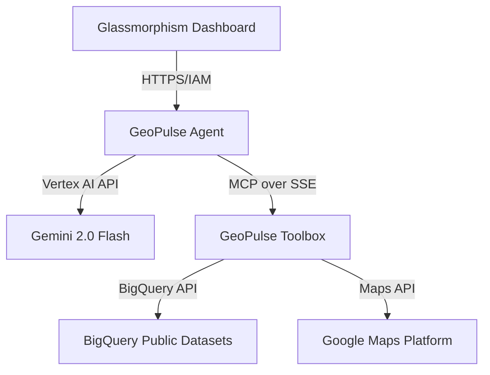

# 🌍 GeoPulse-MCP: Agentic Location Intelligence

[](https://github.com/sivasubramanian86/geo_pulse_mcp)
[](https://cloud.google.com/)
[](https://modelcontextprotocol.io/)
[](https://opensource.org/licenses/MIT)

## 📖 Problem Statement & Solution

**The Problem:** Small to medium enterprises often struggle with "Site Selection Blindness." Accessing reliable demographic data, competitor density, and foot-traffic indicators usually requires expensive consultants or manual consolidation of fragmented datasets (Census, Maps, Business Listings).

**The Solution:** GeoPulse-MCP provides an **Agentic Site Selection Engine**. By simply entering a ZIP code, an AI Agent orchestrates a "Tool mesh" to:
1.  Query **BigQuery Public Datasets** for real-time demographic insights.
2.  Analyze **Google Maps Platform** for competitor positioning and local amenities.
3.  Synthesize a **Strategic Site Report** using Gemini 2.0, providing actionable "Go/No-Go" recommendations.

---

## 🏗️ 3-Tier Architecture

GeoPulse follows a decoupled, production-grade 3-tier architecture:



### 1. **GeoPulse-Dashboard (Frontend)**
- **Tech Stack:** Vanilla JS, HTML5, CSS3 (Glassmorphism), Nginx.
- **Key Feature:** Dynamic Markdown rendering via `marked.js` with premium dark-mode aesthetics.

### 2. **GeoPulse-Agent (The Orchestrator)**
- **Tech Stack:** Python 3.12, Google ADK (Agent SDK), Vertex AI.
- **Key Feature:** Manages complex multi-step reasoning cycles to decide when to call BigQuery vs. Maps.

### 3. **GeoPulse-Toolbox (The Execution Layer)**
- **Tech Stack:** Python, FastMCP (Model Context Protocol), BigQuery, Google Maps API.
- **Key Feature:** Exposes high-fidelity data tools via secure SSE transport.

---

## ☁️ Google Cloud Services Used

| Service | Purpose |
|---|---|
| **Cloud Run** | Serverless hosting for Frontend, Agent, and Toolbox (Container-native). |
| **Vertex AI** | Powering the Gemini 2.0 Flash model for reasoning and synthesis. |
| **BigQuery** | Accessing the `census_bureau_usa` public dataset for demographic truth. |
| **Maps Platform** | Fetching local amenities and competitor data via Places API. |
| **Secret Manager** | Securely storing API keys and service account credentials. |
| **IAM** | Least-privilege service-to-service authentication. |

---

## 🛠️ Integrated MCP Tools

| Tool | Input | Data Source | Description |
|---|---|---|---|
| `get_population_insights` | `zip_code` | BigQuery | Real-time population, gender split, and median age. |
| `get_nearby_amenities` | `location` | Maps API | Identifies competitors and foot-traffic drivers. |

---

## 🚀 Deployment Instructions

### Prerequisites
- Google Cloud Project ID.
- Google Cloud SDK (`gcloud`) installed and configured.

### Automated Deployment
Run the integrated deployment script:
```powershell
.\startup_local.bat --deploy-prod
```

*Built with ❤️ for the Gen AI APAC Hackathon 2026 using Gemini & Antigravity.*
